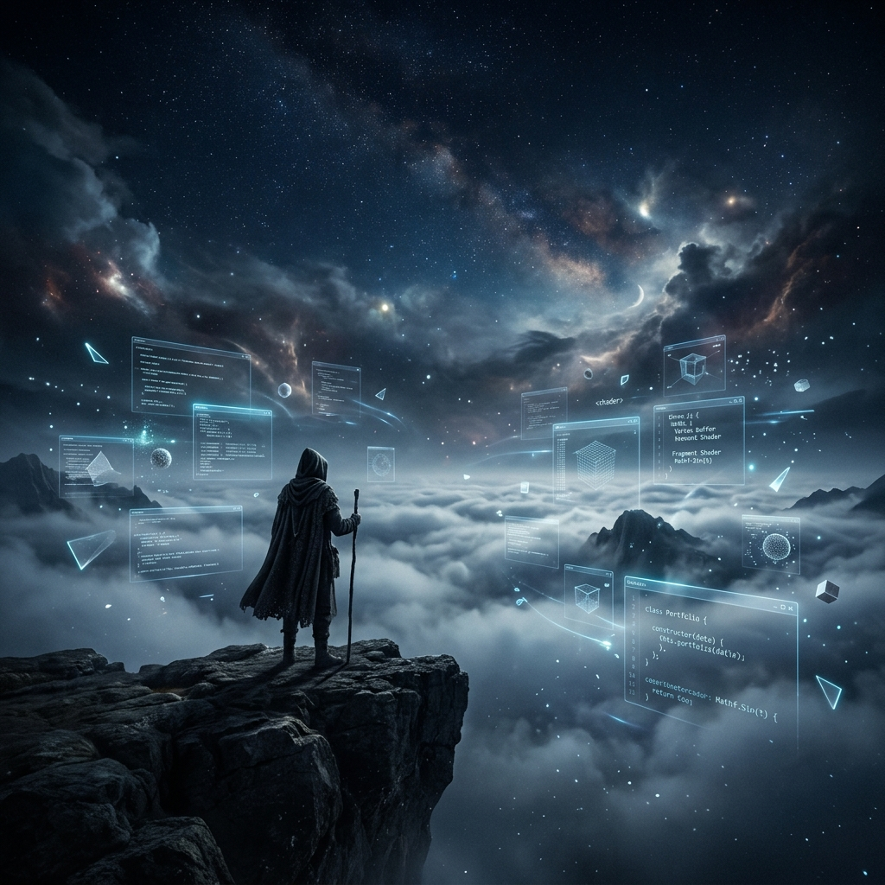
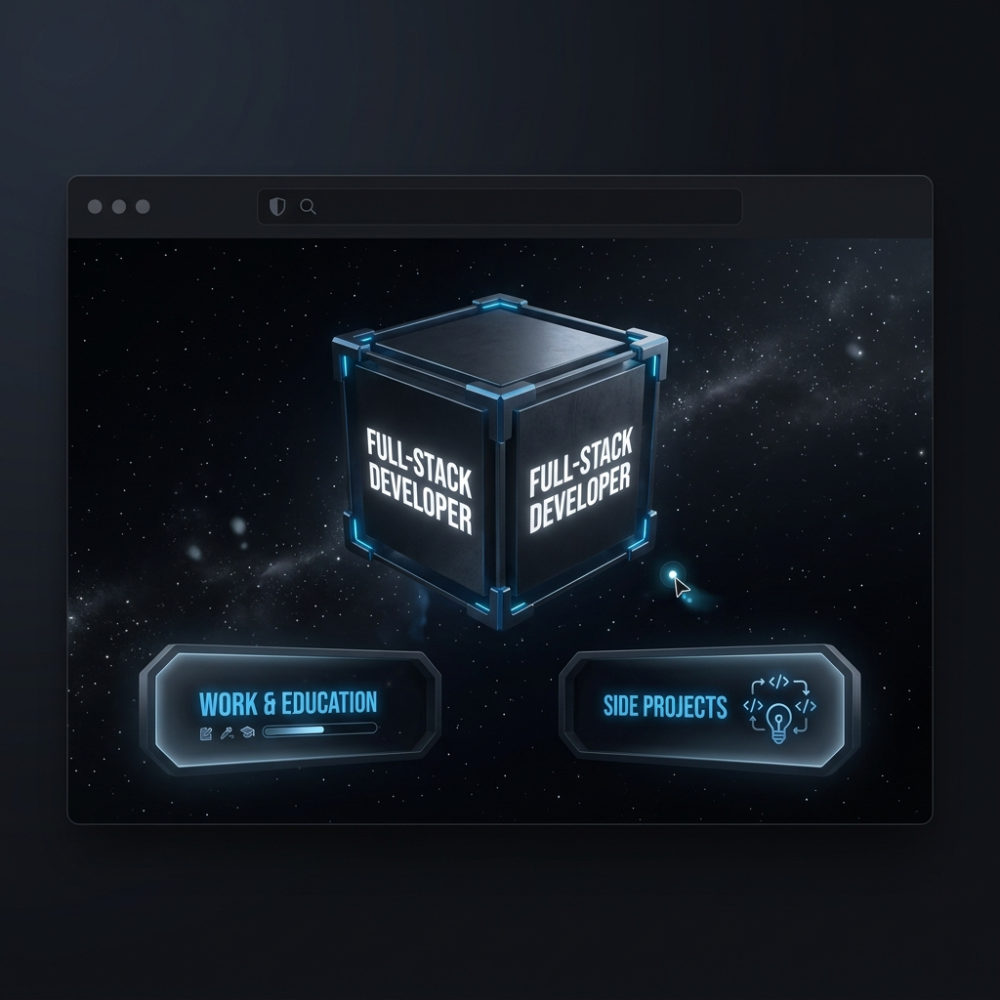
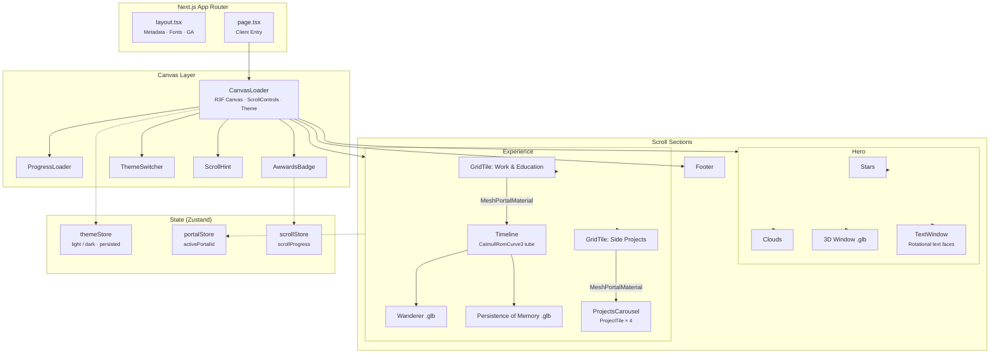

<p align="center">
  
</p>

<h1 align="center">
  <br/>
  <a href="https://github.com/Joylan9">
    
  </a>
  <br/>
</h1>

<p align="center">
  <em>An immersive, scroll-driven 3D portfolio — built with WebGL, fine art, and obsessive attention to detail.</em>
</p>

<p align="center">
  <a href="https://nextjs.org"></a>
  <a href="https://react.dev"></a>
  <a href="https://docs.pmnd.rs/react-three-fiber"></a>
  <a href="https://gsap.com"></a>
  <a href="https://tailwindcss.com"></a>
  <a href="https://www.typescriptlang.org"></a>
</p>

<br/>

---

<br/>

## The Concept

This is not a conventional portfolio. It is a **cinematic, scroll-driven 3D experience** rendered entirely in WebGL. The visitor is taken on a journey — falling through a starfield, drifting past clouds, landing at a typographic window floating in space, then descending through portal-based sections that reveal work history and projects as immersive sub-scenes.

The visual language draws from classical fine art — **Caspar David Friedrich's *Wanderer Above the Sea of Fog*** and **Salvador Dalí's *The Persistence of Memory*** — reimagined as interactive 3D models in the browser.

<p align="center">
  
</p>

<br/>

---

<br/>

## Features

| | |
|---|---|
| **Immersive 3D Hero** | Full-scene WebGL canvas with scroll-controlled camera. "Hi, I am Joylan." rendered in 3D space with the Soria serif typeface, animated via GSAP. |
| **Particle Systems** | Dynamic starfield and volumetric cloud layers surround the scene, generated with Three.js geometry. |
| **3D Art Models** | `.glb` models of Friedrich's *Wanderer* and Dalí's *Persistence of Memory* loaded via Drei's `useGLTF`. |
| **Portal Sections** | `MeshPortalMaterial` opens Work/Education and Side Projects into fully contained 3D sub-environments when clicked. |
| **Interactive Project Cards** | Carousel of project tiles with hover expansion on desktop, touch-pan controls and swipe on mobile. |
| **3D Work Timeline** | Education and experience entries plotted along a `CatmullRomCurve3` tube with year markers in 3D space. |
| **Dual Theme** | Light (`#0690D4`) and Dark (`#111`) modes persisted via Zustand, with GSAP-animated canvas + badge transitions. |
| **SVG Border Loader** | Desktop: full-viewport rectangle trace. Mobile: minimal progress bar. Both driven by `useProgress`. |
| **Awwards Badge** | Scroll-reactive, theme-aware side badge with GSAP inertia tracking. |
| **Responsive by Design** | Triangle portal geometries on mobile, abbreviated layouts, `react-device-detect` gating, adaptive DPR. |
| **SEO** | OpenGraph + Twitter Card metadata, `robots.ts`, `sitemap.ts`, Google Analytics integration. |

<br/>

---

<br/>

## Architecture



<br/>

---

<br/>

## Tech Stack

<table>
  <tr>
    <th>Category</th>
    <th>Technology</th>
  </tr>
  <tr>
    <td><strong>Framework</strong></td>
    <td>
      
      
    </td>
  </tr>
  <tr>
    <td><strong>Language</strong></td>
    <td>
      
    </td>
  </tr>
  <tr>
    <td><strong>3D / WebGL</strong></td>
    <td>
      
      
      
    </td>
  </tr>
  <tr>
    <td><strong>Animation</strong></td>
    <td>
      
    </td>
  </tr>
  <tr>
    <td><strong>State</strong></td>
    <td>
      
    </td>
  </tr>
  <tr>
    <td><strong>Styling</strong></td>
    <td>
      
      
    </td>
  </tr>
  <tr>
    <td><strong>Quality</strong></td>
    <td>
      
      
    </td>
  </tr>
  <tr>
    <td><strong>Analytics</strong></td>
    <td>
      
      
    </td>
  </tr>
  <tr>
    <td><strong>Typography</strong></td>
    <td>Soria <em>(serif display)</em> · Vercetti <em>(sans-serif body)</em></td>
  </tr>
</table>

<br/>

---

<br/>

## Projects Showcased

<table>
  <tr>
    <td width="50%">
      <h3>Enterprise Agentic AI Platform</h3>
      <sup>Python · FastAPI · Ollama · MongoDB · Docker</sup>
      <br/><br/>
      Agentic AI backend with goal decomposition, tool routing, and plan execution using local LLM (LLaMA3). Features a RAG pipeline with sentence-transformer embeddings, enterprise patterns (circuit breaker, retry policies, structured logging), and multi-stage Docker deployment.
      <br/><br/>
      <a href="https://github.com/Joylan9/genai-agent-sprint"></a>
    </td>
    <td width="50%">
      <h3>Sovir Technologies Web Portal</h3>
      <sup>React · Node.js · Express.js · MongoDB</sup>
      <br/><br/>
      Full-stack company portal and admin management system with JWT-based dual authentication, role-based access control, admin dashboard for training programs, and automated Nodemailer notifications.
      <br/><br/>
      <a href="https://www.sovirtechnologies.in/"></a>
      <a href="https://github.com/Joylan9"></a>
    </td>
  </tr>
  <tr>
    <td width="50%">
      <h3>Sovir Training Platform</h3>
      <sup>React 19 · Vite 7 · TailwindCSS 4 · Firebase</sup>
      <br/><br/>
      Production-grade LMS for language and industrial courses. 19 data models, 14 RESTful APIs, Google OAuth 2.0 SSO, Google Calendar batch scheduling, attendance tracking, and Framer Motion animations.
      <br/><br/>
      <a href="https://training.sovirtechnologies.in/"></a>
      <a href="https://github.com/Joylan9"></a>
    </td>
    <td width="50%">
      <h3>Examination Portal</h3>
      <sup>Full-Stack · JWT · RBAC · Audit Logging</sup>
      <br/><br/>
      End-to-end online exam management for institutions, trainers, and candidates. Dynamic exam engine with timed assessments, auto-submission, response tracking, result generation, and multi-role dashboards.
      <br/><br/>
      <a href="https://examportal.sovirakademie.com/"></a>
      <a href="https://github.com/Joylan9"></a>
    </td>
  </tr>
</table>

<br/>

---

<br/>

## Getting Started

### Prerequisites

- **Node.js** ≥ 18
- **npm** (ships with Node)

### Install & Run

```bash
# Clone the repository
git clone https://github.com/Joylan9/Joylan-Portfolio.git
cd Joylan-Portfolio/my-portfolio

# Install dependencies
npm install

# Start the development server
npm run dev
```

Open **[http://localhost:3000](http://localhost:3000)** — the 3D scene will begin loading.

### Other Scripts

| Command | Description |
|---|---|
| `npm run build` | Production build via Next.js |
| `npm run start` | Serve the production build |
| `npm run lint` | Run ESLint across the codebase |

### Environment Variables

| Variable | Purpose | Required |
|---|---|---|
| `NEXT_PUBLIC_SITE_URL` | Canonical URL for SEO (sitemap, robots, OG) | Optional |
| `GA_MEASUREMENT_ID` | Google Analytics measurement ID (production only) | Optional |
| `NEXT_PUBLIC_GA_ID` | Google Analytics client-side ID | Optional |

<br/>

---

<br/>

## Project Structure

```
my-portfolio/
├── app/
│   ├── components/
│   │   ├── common/
│   │   │   ├── AwwardsBadge.tsx       # Scroll-reactive side badge
│   │   │   ├── CanvasLoader.tsx       # R3F Canvas, ScrollControls, theme
│   │   │   ├── Preloader.tsx          # Suspense fallback
│   │   │   ├── ProgressLoader.tsx     # SVG border-trace loader
│   │   │   ├── ScrollHint.tsx         # Scroll affordance indicator
│   │   │   ├── ScrollWrapper.tsx      # Scroll progress tracker
│   │   │   └── ThemeSwitcher.tsx      # Light/dark toggle
│   │   ├── experience/
│   │   │   ├── GridTile.tsx           # Portal tile with MeshPortalMaterial
│   │   │   ├── Triangle.tsx           # Mobile triangle geometry
│   │   │   ├── index.tsx              # Experience section orchestrator
│   │   │   ├── projects/
│   │   │   │   ├── ProjectTile.tsx    # Individual project card
│   │   │   │   ├── ProjectsCarousel.tsx # Carousel container
│   │   │   │   ├── TouchPanControls.tsx # Mobile swipe handling
│   │   │   │   └── index.tsx
│   │   │   └── work/
│   │   │       ├── Timeline.tsx       # CatmullRomCurve3 3D timeline
│   │   │       └── index.tsx          # Work section with art models
│   │   ├── footer/
│   │   │   └── index.tsx              # Social links (3D text / SVG icons)
│   │   ├── hero/
│   │   │   ├── TextWindow.tsx         # Rotating text on 3D window faces
│   │   │   └── index.tsx              # Hero scene: title, stars, clouds, window
│   │   └── models/
│   │       ├── Cloud.tsx              # Procedural cloud particles
│   │       ├── Memory.tsx             # Dalí's Persistence of Memory .glb
│   │       ├── Stars.tsx              # Star particle field
│   │       ├── Wanderer.tsx           # Friedrich's Wanderer .glb
│   │       └── WindowModel.tsx        # 3D window frame .glb
│   ├── constants/
│   │   ├── footer.ts                  # Social links data
│   │   ├── projects.ts               # Project entries
│   │   └── work.ts                    # Timeline entries (3D points)
│   ├── stores/
│   │   ├── portalStore.ts             # Active portal state
│   │   ├── scrollStore.ts             # Scroll progress state
│   │   └── themeStore.ts              # Theme state (persisted)
│   ├── types/                         # TypeScript interfaces
│   ├── globals.css                    # TailwindCSS + custom scrollbar + theme vars
│   ├── layout.tsx                     # Root layout, fonts, metadata
│   ├── page.tsx                       # Home page entry
│   ├── robots.ts                      # SEO robots config
│   └── sitemap.ts                     # SEO sitemap config
├── public/
│   ├── models/
│   │   ├── dalithe_persistence_of_memory.glb
│   │   ├── wanderer_above_the_sea_of_fog.glb
│   │   └── window.glb
│   ├── icons/                         # SVG icons (social, theme, nav)
│   ├── Joylan_Dsouza_Resume.pdf
│   ├── soria-font.ttf                 # Soria serif display font
│   ├── Vercetti-Regular.woff          # Vercetti sans-serif font
│   └── favicon-*.png
├── assets/readme/                     # README images
├── next.config.ts
├── tsconfig.json
├── package.json
└── postcss.config.mjs
```

<br/>

---

<br/>

## Customization

To personalize this portfolio for your own use:

| What | Where |
|---|---|
| Name & bio | `app/layout.tsx` — metadata fields |
| Hero title | `app/components/hero/index.tsx` — `"Hi, I am Joylan."` |
| Taglines | `app/components/hero/TextWindow.tsx` — face text |
| Social links | `app/constants/footer.ts` |
| Projects | `app/constants/projects.ts` |
| Work / Education | `app/constants/work.ts` — timeline entries with 3D coordinates |
| Resume PDF | `public/Joylan_Dsouza_Resume.pdf` + path in `app/constants/footer.ts` |
| OG image | `app/opengraph-image.png` |
| Favicon | `app/favicon.ico` + `public/favicon-*.png` |

<br/>

---

<br/>

## Contributing

1. **Fork** the repository
2. Create a feature branch: `git checkout -b feat/your-feature`
3. Commit with clear messages: `git commit -m "feat: add particle density control"`
4. Push to your fork: `git push origin feat/your-feature`
5. Open a **Pull Request**

Pre-commit hooks (Husky + lint-staged) will auto-lint staged `.ts` / `.tsx` files on commit.

<br/>

---

<br/>

## License

Based on a template by [mohitvirli](https://github.com/mohitvirli).

<br/>

---

<br/>

<p align="center">
  <a href="https://linkedin.com/in/joylan-dsouza-31b056263"></a>
  &nbsp;
  <a href="https://github.com/Joylan9"></a>
  &nbsp;
  <a href="https://www.instagram.com/joylan_7"></a>
</p>

<p align="center">
  <sub>Designed and built by <strong>Joylan Dsouza</strong> — Mangalore, India</sub>
</p>
